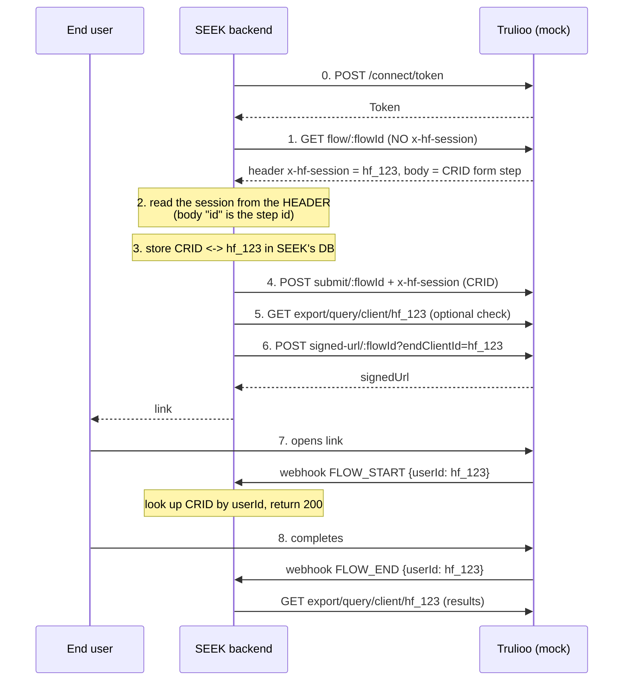

# CRID ↔ x-hf-session demo (MOCK)

> **MOCK DEMO. This is not Trulioo.** No real Trulioo calls, credentials or personal data. Everything runs in memory on localhost.

Shows how a customer (here, "SEEK") links its own `CustomerReferenceID` (CRID) to a Trulioo Workflow Studio session (`x-hf-session`) **before** the end user starts verification, and what goes wrong when the webhook handler calls `GET flow` without the session header.

## Run

```bash
npm install && npm start
```

Open <http://localhost:3000>. To use another port: `PORT=3456 npm start`.

Requires Node 18+. The only dependency is `express`.

## Hosting it (Render)

1. Put the folder in a Git repo (GitHub/GitLab) and push it. `node_modules` is already git-ignored.
2. In Render: **New → Blueprint**, pick the repo. It reads `render.yaml` (Node web service, `npm install` / `npm start`).
3. When prompted, set `DEMO_PASSWORD` to a shared password for SEEK. Any username works.
4. Deploy, then share the `https://<name>.onrender.com` URL and the password.

Notes:
- `PUBLIC_URL` is detected automatically on Render (`RENDER_EXTERNAL_URL`) and Railway (`RAILWAY_PUBLIC_DOMAIN`). Elsewhere (Fly.io, your own host) set `PUBLIC_URL=https://your-host`. It is used for the signed URLs and the URLs shown in requests.
- Each visitor gets their own isolated state via a cookie, so several people can use it at once and **Reset** only affects them. Idle workspaces are dropped after 2 hours and a restart wipes everything.
- The free Render tier sleeps when idle, so the first load can take ~30s.
- `DEMO_PASSWORD` gates everything except the end-user `/launch/...` links, which are protected by an unguessable token so they open on a phone without a password prompt. Leave it unset locally.
- Railway: create a project from the repo and add `DEMO_PASSWORD`. Fly.io: `fly launch`, then `fly secrets set DEMO_PASSWORD=... PUBLIC_URL=...`.

## What's in the box

| Part | Where | Role |
|---|---|---|
| Fake Trulioo | `/trulioo/*`, `/launch/*` in `server.js` | Token, flow, submit, signed-url, export query, webhook dispatcher, end-user launch page |
| SEEK backend | `/seek/*` in `server.js` | `start-verification`, `webhook`, mapping table, BROKEN-mode toggle |
| Frontend | `public/index.html` | Guided stepper, mapping table, end-user phone, bug panel |

## The flow



## Things to try

- **Guided mode** (default): Start a customer, then press Next. Each step shows the plain-English reason, the exact request and response, and which component is acting.
- **Run all steps**: runs steps 0-6 at once; click any step number to inspect it.
- **Break it on purpose**: tick one or more faults. Before the affected step runs, a prompt shows the exact error to expect, then the real response appears in the step view.

  | Fault | Step | Result |
  |---|---|---|
  | Omit the Authorization header | 1 | `401 Unauthorized`, no session, flow stops |
  | Use the body `id` as the session | 2 | `404 {"code":4100}` at steps 4, 5, 6; no signed URL |
  | Skip storing CRID ↔ session | 3 | webhook lookup finds no row (unknown session) |
  | Omit `x-hf-session` on submit | 4 | `400`, CRID not stored |
  | Submit an empty CRID | 4 | `400`, CRID not stored |
  | Omit `endClientId` | 6 | `200` but a NEW session: mapping mismatch |

- **Show me the bug**: switches the webhook to BROKEN mode and opens Customer A's link. The handler calls `GET flow` with no `x-hf-session` on every event, creating a session, which fires `FLOW_START`, which re-triggers the handler. A safety cap stops it at 25 sessions. **Fix it** switches back.
- **Replay last event**: re-sends the same webhook event id; SEEK dedupes it.

## What is mocked vs real

**Mirrors real Trulioo behaviour**
- Paths: `/connect/token`, `/wfs/interpreter-v2/flow|submit|signed-url`, `/wfs/export/v2/query/client/:id`.
- Header-less `GET flow` creates a session and returns it in the `x-hf-session` response header; the body `id` is a step id.
- `signed-url` without `endClientId` creates a new session.
- Unknown session returns `404 {"code":4100,...}`.
- Webhook payload shape `{"id", "event": {"type", "userId"}}` with `userId` = `x-hf-session`.

**Simplified or invented for the demo**
- Submit body is `{"fieldData": {"<elementId>": "<value>"}}`, not the real format.
- Export profile only has `id`, `status` and `flowData.<node>.fieldData.<fieldId>.value`.
- The error bodies for 400/401 are plausible, not copied from real Trulioo (the 404 code 4100 text is).
- Any non-empty `client_id`/`client_secret` is accepted; tokens never expire.
- The launch page and its QR code are placeholders (not scannable).
- Trulioo fires `FLOW_START` when the launch page loads and `FLOW_END` when its button is clicked. No webhook retries or signatures.
- **Demo shim:** to make the feedback loop visible, the broken handler's `GET flow` carries an `x-demo-fire-start: 1` header that tells the mock to emit `FLOW_START` for the new session. That header does not exist in reality.
- The 25-session cap is a demo safety, not Trulioo behaviour.
- All state is in memory; **Reset** wipes it.

**Styling:** uses Trulioo's brand palette; Times New Roman and Arial stand in for Tobias and Founders Grotesk. It is deliberately not a Trulioo-branded product: the logo is not used and the "MOCK DEMO" banner stays.
